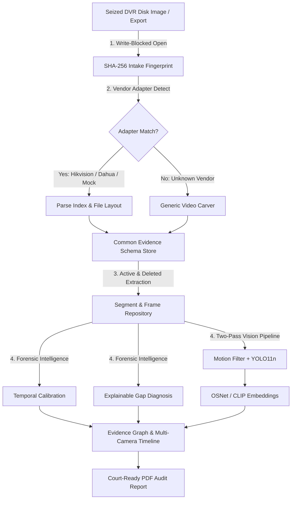

# FORENSIC-X: Architecture & Pipeline Specification

## 🔄 6-Stage Forensic Pipeline

---

## ⚡ Two-Pass AI Vision Strategy

Analyzing 20 hours of 25 fps video per camera yields **1.8 million frames per camera**. Running dense object detection on every frame is computationally prohibitive and unnecessary for forensics.

### Pass 1: Cheap Ingestion Filtering
1. **Frame Sampling**: Extract 1 frame per second (25x reduction $\rightarrow$ 72,000 frames).
2. **Motion Gating**: OpenCV background subtraction checks for pixel variance. Empty, motionless footage (often 70–90% of surveillance duration) is discarded before model inference.
3. **Nano Detector**: Ultralytics YOLO11n runs on candidate frames at >100 FPS on GPU. Detections and timestamps are stored in SQLite.

### Pass 2: Targeted Re-ID & Visual Search
1. Investigator selects an incident time window (e.g. 21:30 to 22:00) or uploads a suspect image.
2. OSNet (person re-ID) extracts appearance embeddings from cropped person detections.
3. CLIP vector search matches natural language descriptions (e.g. *"dark cap and red jacket"*).
4. Matches are ranked by similarity and projected across all synchronized cameras on the **Path View**.
