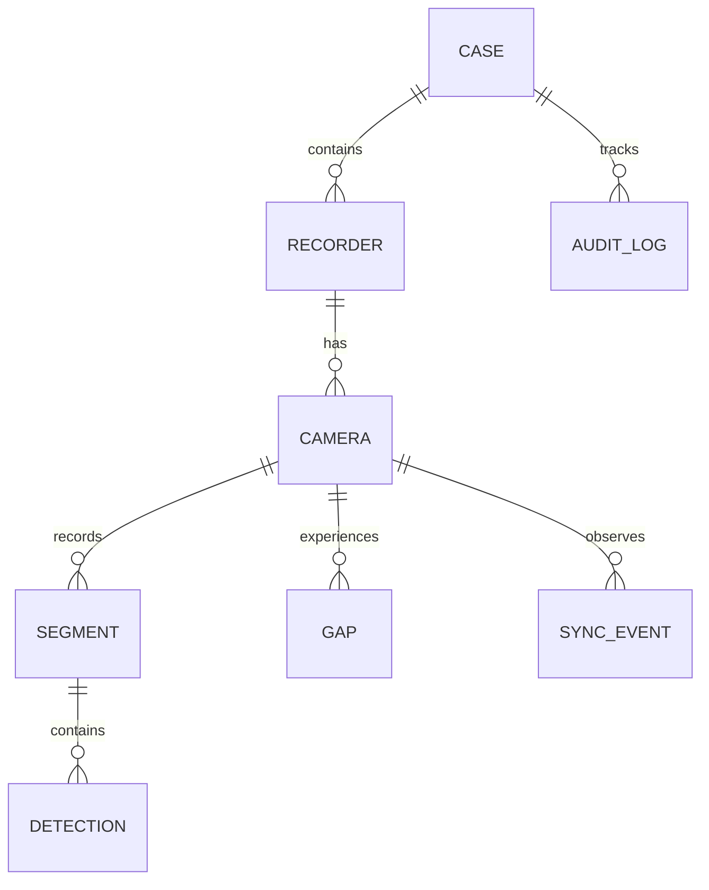

# FORENSIC-X: Common Evidence Schema (Database Specification)

The platform normalizes disparate vendor CCTV disk layouts and exports into a **single common evidence schema** stored in SQLite (and later PostgreSQL). Every row anchors back to a cryptographic SHA-256 hash.

---

## 🗄️ Relational Entity-Relationship Diagram

---

## 📋 Database Tables

### 1. `cases`
| Column | Type | Constraints | Description |
| :--- | :--- | :--- | :--- |
| `id` | TEXT (UUID) | PRIMARY KEY | Unique case identifier |
| `name` | TEXT | NOT NULL | Case title (e.g. "Store Theft 2026-10-17") |
| `status` | TEXT | 'new' \| 'processing' \| 'ready' | Case processing status |
| `incident_time`| TEXT | ISO-8601 | Estimated incident timestamp |
| `created_at` | TEXT | NOT NULL | Creation timestamp |

### 2. `recorders`
| Column | Type | Constraints | Description |
| :--- | :--- | :--- | :--- |
| `id` | TEXT (UUID) | PRIMARY KEY | Unique recorder ID |
| `case_id` | TEXT | FOREIGN KEY `cases(id)` | Parent case |
| `brand` | TEXT | NOT NULL | Detected brand (e.g. "Hikvision", "MockDVR1") |
| `adapter_used` | TEXT | NOT NULL | Adapter name or "generic_carver" |
| `image_hash` | TEXT (CHAR 64) | NOT NULL | SHA-256 of raw seized disk image |
| `acquired_at` | TEXT | NOT NULL | Ingestion timestamp |

### 3. `cameras`
| Column | Type | Constraints | Description |
| :--- | :--- | :--- | :--- |
| `id` | TEXT (UUID) | PRIMARY KEY | Unique camera ID |
| `recorder_id` | TEXT | FOREIGN KEY `recorders(id)` | Parent recorder |
| `channel` | INTEGER | NOT NULL | Channel index on recorder (1-indexed) |
| `location_name`| TEXT | NOT NULL | Location label (e.g. "Main Entrance") |
| `clock_offset_s`| REAL | DEFAULT 0.0 | Estimated clock drift in seconds |
| `offset_error_s`| REAL | DEFAULT 0.0 | Uncertainty margin ($\pm$ seconds) |
| `status` | TEXT | 'ok' \| 'gaps' \| 'offset_uncertain' | Camera health status |

### 4. `segments` (Active & Recovered Video)
| Column | Type | Constraints | Description |
| :--- | :--- | :--- | :--- |
| `id` | TEXT (UUID) | PRIMARY KEY | Segment identifier |
| `camera_id` | TEXT | FOREIGN KEY `cameras(id)` | Associated camera |
| `start_original`| TEXT | ISO-8601 NOT NULL | Timestamp as recorded on camera |
| `start_corrected`| TEXT | ISO-8601 NOT NULL | Normalized time after clock calibration |
| `duration_s` | REAL | NOT NULL | Duration in seconds |
| `status` | TEXT | 'active' \| 'recovered' \| 'partial' | Video recovery state |
| `method` | TEXT | 'index' \| 'carved' | Extraction methodology |
| `sha256_hash` | TEXT (CHAR 64) | NOT NULL | Cryptographic hash of video segment |
| `file_path` | TEXT | NOT NULL | Path to playable video segment |

### 5. `gaps` (Missing Footage Intervals)
| Column | Type | Constraints | Description |
| :--- | :--- | :--- | :--- |
| `id` | TEXT (UUID) | PRIMARY KEY | Gap identifier |
| `camera_id` | TEXT | FOREIGN KEY `cameras(id)` | Associated camera |
| `start_time` | TEXT | ISO-8601 NOT NULL | Missing interval start |
| `end_time` | TEXT | ISO-8601 NOT NULL | Missing interval end |
| `verdict` | TEXT | NOT NULL | Most probable cause or "undetermined" |
| `confidence` | REAL | 0.0 – 1.0 | Probabilistic confidence score |
| `evidence_for` | TEXT (JSON) | Array of strings | Clues supporting verdict |
| `evidence_against`| TEXT (JSON)| Array of strings | Clues contradicting verdict |

### 6. `detections` (Vision Pass 1 & Pass 2)
| Column | Type | Constraints | Description |
| :--- | :--- | :--- | :--- |
| `id` | TEXT (UUID) | PRIMARY KEY | Detection record |
| `segment_id` | TEXT | FOREIGN KEY `segments(id)` | Origin video segment |
| `camera_id` | TEXT | FOREIGN KEY `cameras(id)` | Camera channel |
| `time_corrected`| TEXT | ISO-8601 NOT NULL | Calibrated detection timestamp |
| `label` | TEXT | NOT NULL | Object label ("person", "backpack") |
| `bbox` | TEXT (JSON) | `[x, y, w, h]` normalized | Bounding box coordinates |
| `embedding` | BLOB | Float32 array | OSNet re-ID or CLIP vector |
| `source_hash` | TEXT (CHAR 64) | NOT NULL | Inherited SHA-256 of parent segment |
